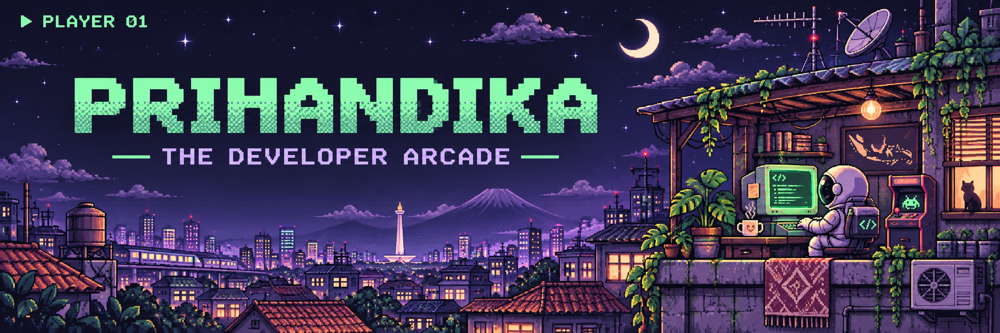
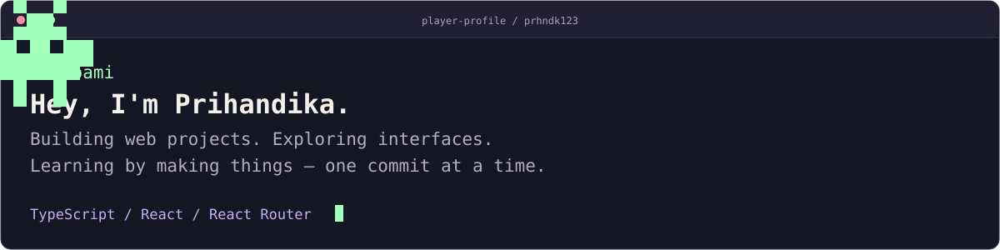
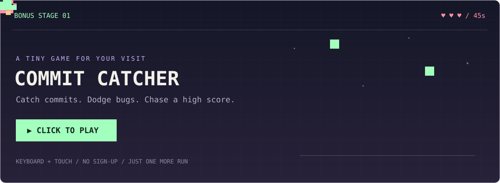
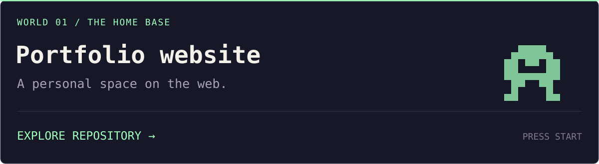
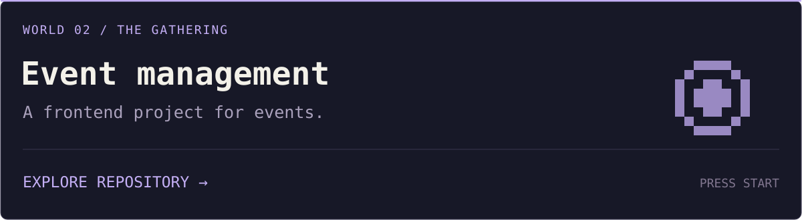
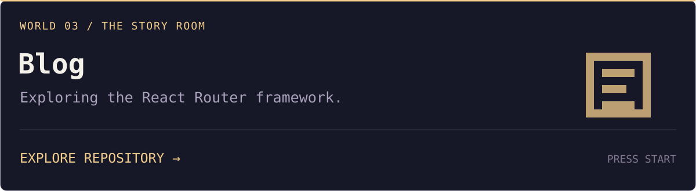
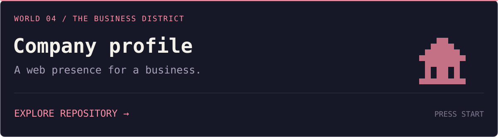
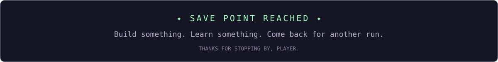

  
  

 

 
 

### 🕹️ BONUS STAGE / COMMIT CATCHER

A tiny arcade I made for your visit. **Catch green commits. Dodge pink bugs. Beat your best.**

<a href="https://prhndk123.github.io/prhndk123/"><strong>INSERT COIN? NAH. JUST CLICK TO PLAY →</strong></a> 45 seconds · keyboard + touch · personal best saved in your browser

 

### 🗺️ QUEST SELECT / MY PROJECTS

Pick a world to explore. Each card opens the source code.

<table>
  <tr>
    <td width="50%"></td>
    <td width="50%"></td>
  </tr>
  <tr>
    <td width="50%"></td>
    <td width="50%"></td>
  </tr>
</table>

<a href="https://github.com/prhndk123?tab=repositories">Unlock the rest of the map ↗</a>

 

### 🎒 INVENTORY / TOOLS I BUILD WITH

  
  
  
  

 

<a href="https://portfolio-website-theta-six-45.vercel.app">Portfolio</a> · <a href="https://github.com/prhndk123?tab=repositories">Projects</a> · <a href="https://prhndk123.github.io/prhndk123/">One more game?</a>

