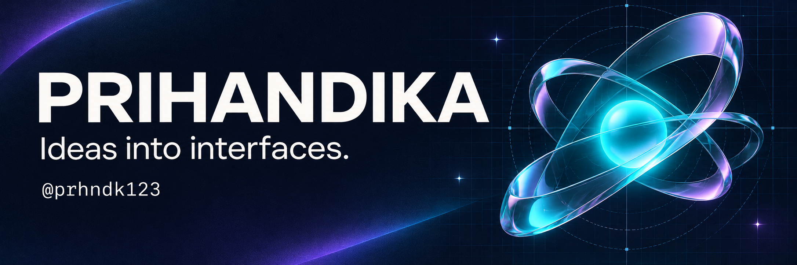
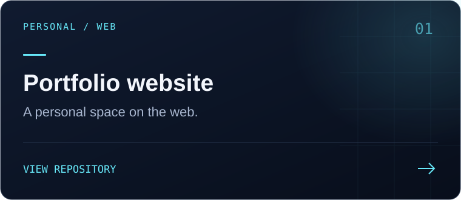
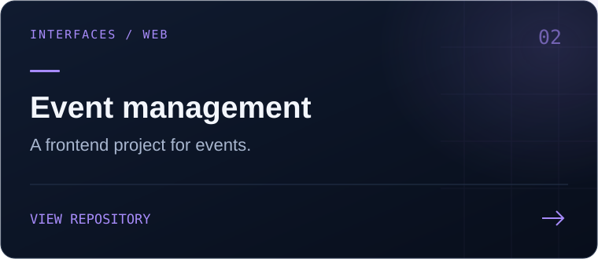
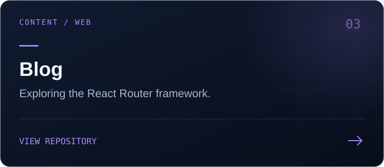
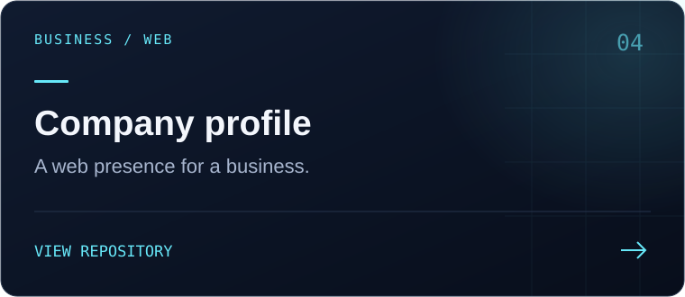

  

  
  

 

### 01 / HELLO, WORLD

I'm **Prihandika**. I build web projects and explore how ideas become useful interfaces.

My projects span personal portfolios, company profiles, blogs, and event management interfaces. This is where I share what I'm building and learning along the way.

 

### 02 / SELECTED WORK

<table>
  <tr>
    <td width="50%"></td>
    <td width="50%"></td>
  </tr>
  <tr>
    <td width="50%"></td>
    <td width="50%"></td>
  </tr>
</table>

<a href="https://github.com/prhndk123?tab=repositories">Browse all repositories →</a>

 

### 03 / IN MY TOOLBOX

  
  
  
  

 

---

  <samp>IDEA → BUILD → LEARN → REPEAT</samp>  
  <a href="https://portfolio-website-theta-six-45.vercel.app">Portfolio</a> · <a href="https://github.com/prhndk123?tab=repositories">Projects</a>

